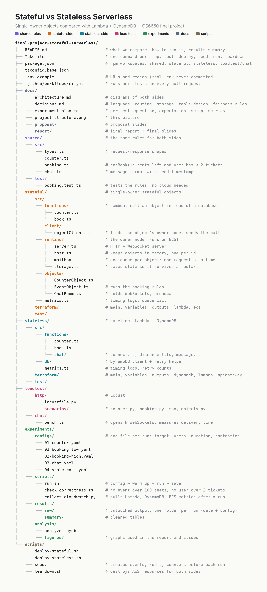

# Stateful vs Stateless Serverless

**Single-Owner Objects Compared with Lambda + DynamoDB**

CS6650 final project. Serverless functions don't keep shared, changing state. The usual fix is a shared database (Lambda + DynamoDB). We build our own version of the idea behind Cloudflare Durable Objects: **single-owner stateful objects**, where every object has exactly one owner that keeps its state in memory and handles its requests one at a time. Then we compare the two on the same jobs to show what makes the single-owner model different and where it shines.

| | Stateless (baseline) | Stateful (single-owner objects) |
|---|---|---|
| Functions | AWS Lambda (Go) | AWS Lambda (Go) |
| State lives in | DynamoDB, a separate service | The object's owner node, in memory + saved to storage |
| Same object, many requests | Run at once and race; conditional writes and retries | Wait in the object's line, one at a time |
| Live connections (chat) | API Gateway WebSockets + connections table | The ChatRoom object holds the sockets |

Both sides use Go, Lambda for the functions, and the same rules from `shared/`, so the difference we measure is the state layer.

## The four tests

1. **Counter (control)**: many users add 1 to counters. We expect about a tie.
2. **Booking under contention**: 100 seats, max 2 tickets per user, many users booking the same event.
3. **Chat room broadcast**: rooms of 10, 100, and 500 people; time from send to everyone receiving.
4. **Many independent objects + cost**: scale out and compare cost per million operations.

## Project structure



| Folder | What goes there |
|---|---|
| `shared/` | Go package with the rules both sides use (counter, booking, chat message format) + tests |
| `stateful/` | Single-owner objects: Lambda functions, the client that finds an object's owner, the owner node, and the objects |
| `stateless/` | Baseline: Lambda functions, DynamoDB access, API Gateway |
| `loadtest/` | Locust scenarios (HTTP) and the Go WebSocket chat benchmark |
| `experiments/` | Run configs, scripts, raw + summary results, analysis notebook |
| `scripts/` | Deploy, seed, and teardown |
| `docs/` | Architecture, design decisions, experiment plan, proposal, report |

Every Go program lives in a `cmd/<name>/main.go` folder. Tests sit next to the code they test (`*_test.go`).

## Getting started

```bash
cp .env.example .env   # fill in your own values, never commit .env
go test ./...
make help
```

## Team

- Weitong
- Jaymin
- Sushil
